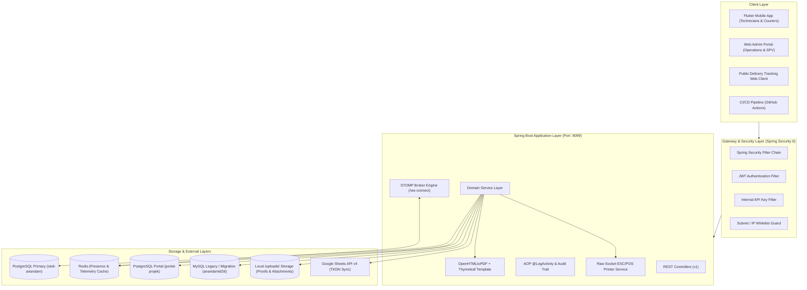
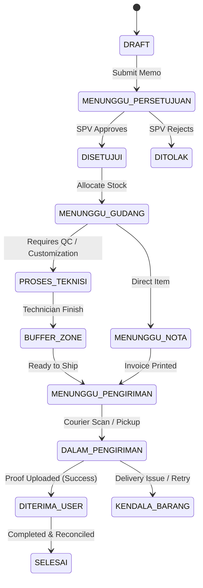
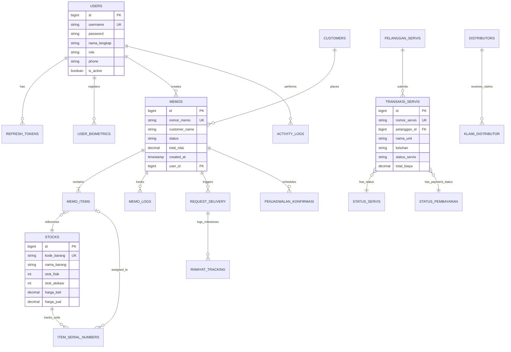
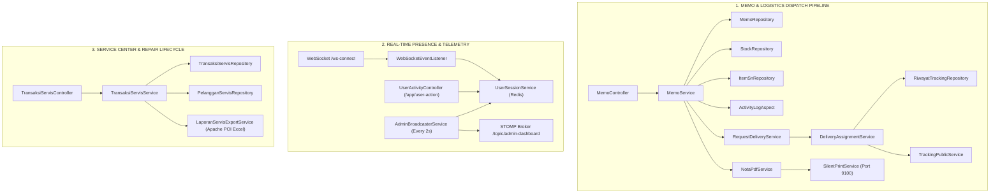

# Technical Documentation: Movva / Anandam Store Backend API

> **Version:** `1.0.0-PROD`  
> **Target Framework:** Spring Boot 4.0.3 / Spring Framework 6.x (Java 17)  
> **System Name:** Movva by Anandam ID (`store`)  
> **Document Status:** Production Ready

---

## Table of Contents
1. [Project Overview](#1-project-overview)
   - [1.1 Purpose & Scope](#11-purpose--scope)
   - [1.2 High-Level Architecture](#12-high-level-architecture)
   - [1.3 Core Business Logic & Algorithms](#13-core-business-logic--algorithms)
2. [Tech Stack](#2-tech-stack)
   - [2.1 Core Frameworks & Runtime](#21-core-frameworks--runtime)
   - [2.2 Persistence & Multi-Datasource Setup](#22-persistence--multi-datasource-setup)
   - [2.3 Real-Time, Messaging & Utilities](#23-real-time-messaging--utilities)
3. [Environment & Configuration](#3-environment--configuration)
   - [3.1 Environment Variables (.env / properties)](#31-environment-variables-env--properties)
   - [3.2 Database Connection Pools (HikariCP)](#32-database-connection-pools-hikaricp)
   - [3.3 Security, JWT & Rate Limiting Config](#33-security-jwt--rate-limiting-config)
4. [Architecture & Database Schema](#4-architecture--database-schema)
   - [4.1 Multi-Datasource Architecture](#41-multi-datasource-architecture)
   - [4.2 Entity Relationship Diagram (ERD)](#42-entity-relationship-diagram-erd)
   - [4.3 Core Data Flows & State Machines](#43-core-data-flows--state-machines)
5. [API Reference](#5-api-reference)
   - [5.1 Standard Response Envelopes](#51-standard-response-envelopes)
   - [5.2 Authentication & Biometrics](#52-authentication--biometrics)
   - [5.3 Stock & Serial Number Tracking](#53-stock--serial-number-tracking)
   - [5.4 Internal Memos & Workflow Lifecycle](#54-internal-memos--workflow-lifecycle)
   - [5.5 Service & Repair Management](#55-service--repair-management)
   - [5.6 Logistics, Delivery & Public Tracking](#56-logistics-delivery--public-tracking)
   - [5.7 Printing & Document Generation](#57-printing--document-generation)
   - [5.8 Application Updates & WebSockets](#58-application-updates--websockets)
6. [Deployment & Infrastructure](#6-deployment--infrastructure)
   - [6.1 Build & Packaging](#61-build--packaging)
   - [6.2 Production Execution (Systemd / Docker)](#62-production-execution-systemd--docker)
   - [6.3 Nginx Reverse Proxy Configuration](#63-nginx-reverse-proxy-configuration)
   - [6.4 Observability, Actuator & Health Checks](#64-observability-actuator--health-checks)
7. [Developer Handoff & End-to-End Feature Wiring Map](#7-developer-handoff--end-to-end-feature-wiring-map)
   - [7.1 Pipeline: Memo Creation to Delivery & Public Tracking](#71-pipeline-memo-creation-to-delivery--public-tracking)
   - [7.2 Pipeline: Real-Time Presence & Live Activity Tracking](#72-pipeline-real-time-presence--live-activity-tracking)
   - [7.3 Pipeline: Service Center & RMA Repair Management](#73-pipeline-service-center--rma-repair-management)
   - [7.4 Pipeline: Dual-Layer Authentication (JWT + Biometrics)](#74-pipeline-dual-layer-authentication-jwt--biometrics)
   - [7.5 Pipeline: TKDN Google Sheets Automated Synchronization](#75-pipeline-tkdn-google-sheets-automated-synchronization)
   - [7.6 Pipeline: CI/CD In-App Mobile Update Engine](#76-pipeline-cicd-in-app-mobile-update-engine)
   - [7.7 Quick Developer Cheat Sheet: Key File Reference](#77-quick-developer-cheat-sheet-key-file-reference)

---

## 1. Project Overview

### 1.1 Purpose & Scope
The **Movva / Anandam Store Backend API** is an enterprise-grade ERP, warehouse logistics, service lifecycle, and inventory tracking backend. It acts as the operational core for Anandam Computer, orchestrating:
* **Multi-Warehouse Stock & Serial Number (SN) Lifecycle:** Tracking unit-level hardware from procurement, warehouse binning, allocation to memos, technician processing, to sales dispatch and RMA warranty claims.
* **Internal Memo & Dispatch State Machine:** A multi-role pipeline transitioning orders across Marketing $\rightarrow$ Warehouse picking $\rightarrow$ Invoicing $\rightarrow$ Technician QA $\rightarrow$ Driver logistics $\rightarrow$ Client handover.
* **Service Center & RMA Management:** Repair ticket diagnostics, spare parts allocation, technician performance tracking, and automated service invoice generation.
* **Real-time Live Presence & Telemetry:** WebSocket STOMP + Redis architecture tracking user activity on mobile and desktop apps every 2 seconds.
* **Automated Document Rendering & Silent Network Printing:** Headless HTML-to-PDF rendering with dynamic ZXing QR code watermarking and raw TCP ESC/POS socket stream output directly to network thermal printers.

---

### 1.2 High-Level Architecture



---

### 1.3 Core Business Logic & Algorithms

#### A. Memo Workflow State Machine
The memo lifecycle follows strict role-based transitions to prevent operational collisions:
1. **Creation:** Created as `DRAFT` or `MENUNGGU_PERSETUJUAN` by Marketing.
2. **Approval:** SPV verifies pricing, stock availability, and client credit; transitions to `DISETUJUI`.
3. **Warehouse Picking:** Warehouse staff pick physical units and assign Serial Numbers via `/gudang-finish` $\rightarrow$ `MENUNGGU_NOTA` or `PROSES_TEKNISI`.
4. **Technical Configuration / Assembly:** Technicians configure software/hardware and finalize QC via `/technician-finish` $\rightarrow$ `BUFFER_ZONE` / `MENUNGGU_PENGIRIMAN`.
5. **Logistics Assignment:** Couriers claim dispatch tasks, scan batch barcodes via `/delivery/scan` $\rightarrow$ `DALAM_PENGIRIMAN`.
6. **Fulfillment / Partial Delivery:** Courier captures recipient signature and GPS photo $\rightarrow$ `DITERIMA_USER` / `SELESAI`.



#### B. Presence & Telemetry Synchronization Algorithm
* Active users establish a STOMP connection to `/ws-connect` carrying HTTP/STOMP headers `userId` and `name`.
* On connection, `WebSocketEventListener` writes user state to Redis with a 5-minute Time-To-Live (TTL): `SET user_session:{userId} {payload} EX 300`.
* As users navigate screens, the client publishes heartbeats to `/app/user-action`.
* Every 2,000ms, `@Scheduled` `AdminBroadcasterService` executes `KEYS user_session:*`, retrieves active JSON descriptors, and broadcasts them to `/topic/admin-dashboard`.

#### C. Silent Network Printing Algorithm (ESC/POS & Dot Matrix)
* The server bypasses client-side print dialogs and OS driver dependencies.
* [`SilentPrintService`](file:///D:/My%20Code/api-stok-anandam/src/main/java/com/stok/anandam/store/service/SilentPrintService.java) creates a raw TCP socket (`java.net.Socket`) directly to the target printer IP on standard port `9100`.
* Injects ESC/POS command sequences (e.g., `ESC @` initialize, `GS V \x00` paper cut, line spacing, dynamic CP437 character formatting) and flushes the binary stream to the printer hardware.

---

## 2. Tech Stack

| Category | Technology / Library | Version / Detail |
| :--- | :--- | :--- |
| **Language & SDK** | Java SDK | OpenJDK 17 LTS |
| **Backend Framework** | Spring Boot | `4.0.3` (Spring Framework 6.x) |
| **Security & Auth** | Spring Security 6, JJWT | `io.jsonwebtoken:jjwt-api:0.11.5` |
| **Primary Database** | PostgreSQL Driver | `org.postgresql:postgresql:42.x` |
| **Connection Pooling**| HikariCP | Built-in high-performance pool |
| **Secondary Database**| PostgreSQL (Portal DB) | `portal-projek` |
| **Legacy Database** | MySQL Connector / H2 | `mysql-connector-java:5.1.49` / H2 Runtime |
| **Caching & PubSub** | Spring Data Redis | Redis standalone / Lettuce client |
| **Real-time Comms** | Spring WebSocket (STOMP)| Over SockJS & Native WebSocket |
| **PDF Rendering** | OpenHTMLtoPDF & PDFBox | `com.openhtmltopdf:openhtmltopdf-pdfbox:1.0.10` |
| **Template Engine** | Thymeleaf Spring 6 | `org.springframework.boot:spring-boot-starter-thymeleaf` |
| **Barcode / QR Code** | ZXing Core & JavaSE | `com.google.zxing:core:3.5.3` |
| **Excel Export / Import**| Apache POI OOXML | `org.apache.poi:poi-ooxml:5.2.3` |
| **External Integration**| Google Sheets API v4 | `com.google.apis:google-api-services-sheets:v4` |
| **API Documentation** | SpringDoc OpenAPI | `org.springdoc:springdoc-openapi-starter-webmvc-ui:3.0.1` |
| **Code Generation** | Project Lombok | `org.projectlombok:lombok` |

---

## 3. Environment & Configuration

### 3.1 Environment Variables (`application.properties` / `.env`)

```properties
# ==============================================================================
# APPLICATION & RUNTIME CONFIGURATION
# ==============================================================================
server.port=9099
spring.application.name=store

# Base Public & Webhook URLs
app.base-url=https://api.anandamcomputer.com
app.tracking-url=https://anandam.id

# ==============================================================================
# POSTGRESQL PRIMARY DATASOURCE (stok-anandam)
# ==============================================================================
DB_PG_HOST=192.168.1.176
DB_PG_PORT=5432
DB_PG_NAME=stok-anandam
DB_PG_USER=anandamstok
DB_PG_PASSWORD=Letmein99+

spring.datasource.pg.jdbc-url=jdbc:postgresql://${DB_PG_HOST}:${DB_PG_PORT}/${DB_PG_NAME}?reWriteBatchedInserts=true&sslmode=prefer
spring.datasource.pg.username=${DB_PG_USER}
spring.datasource.pg.password=${DB_PG_PASSWORD}
spring.datasource.pg.driver-class-name=org.postgresql.Driver

# HikariCP Pool Settings (Primary)
spring.datasource.pg.hikari.maximum-pool-size=10
spring.datasource.pg.hikari.minimum-idle=0
spring.datasource.pg.hikari.idle-timeout=60000
spring.datasource.pg.hikari.max-lifetime=1800000

# ==============================================================================
# POSTGRESQL PORTAL DATASOURCE (portal-projek)
# ==============================================================================
DB_PORTAL_HOST=192.168.1.176
DB_PORTAL_PORT=5432
DB_PORTAL_NAME=portal-projek
DB_PORTAL_USER=tim_projek
DB_PORTAL_PASSWORD=Letmein9+9

spring.datasource.portal.jdbc-url=jdbc:postgresql://${DB_PORTAL_HOST}:${DB_PORTAL_PORT}/${DB_PORTAL_NAME}?currentSchema=public&sslmode=prefer
spring.datasource.portal.username=${DB_PORTAL_USER}
spring.datasource.portal.password=${DB_PORTAL_PASSWORD}
spring.datasource.portal.driver-class-name=org.postgresql.Driver
spring.datasource.portal.hikari.maximum-pool-size=5
spring.datasource.portal.hikari.minimum-idle=0
spring.datasource.portal.hikari.idle-timeout=60000
spring.datasource.portal.hikari.max-lifetime=1800000

# ==============================================================================
# REDIS CONFIGURATION (Presence & Ephemeral Sessions)
# ==============================================================================
spring.redis.host=localhost
spring.redis.port=6379

# ==============================================================================
# SECURITY, JWT & INTEGRATION KEYS
# ==============================================================================
JWT_SECRET=KunciRahasiaIniHarusSangatPanjangDanAmanSekali32KarakterLebih
jwt.expiration=5400000
jwt.refresh-expiration=604800000
app.internal-api-key=KUNCIRAHASIAJANGANSAMPAIORANGLAINTAU2026

# ==============================================================================
# JPA & HIBERNATE PERFORMANCE
# ==============================================================================
spring.jpa.hibernate.ddl-auto=update
spring.jpa.show-sql=false
spring.jpa.properties.hibernate.jdbc.batch_size=50
spring.jpa.properties.hibernate.order_inserts=true
spring.jpa.properties.hibernate.order_updates=true

# Multipart Upload Limits
spring.servlet.multipart.max-file-size=10MB
spring.servlet.multipart.max-request-size=10MB
```

---

## 4. Architecture & Database Schema

### 4.1 Multi-Datasource Architecture

The application defines distinct JPA EntityManagers and TransactionManagers:
1. **Primary Postgres Configuration (`PostgresConfig.java`):** Scans package `com.stok.anandam.store.core.postgres`. Controls all core operational entities.
2. **Portal Postgres Configuration (`PortalConfig.java`):** Scans package `com.stok.anandam.store.core.portal`. Manages canvasing and external project schedules.
3. **Legacy Migration Configuration (`MysqlConfig.java` / `LegacyDbConfig.java`):** Controls schema synchronization from older systems.

---

### 4.2 Entity Relationship Diagram (ERD)



---

## 5. API Reference

### 5.1 Standard Response Envelopes

All REST endpoints return standardized JSON payloads:

#### Success Response Envelope (`WebResponse<T>`)
```json
{
  "status": 200,
  "message": "Operation successful description",
  "data": {},
  "paging": {
    "currentPage": 1,
    "totalPage": 10,
    "size": 20,
    "totalItem": 195
  }
}
```

#### Standard Error Response Envelope
```json
{
  "code": "ERROR_CODE_IDENTIFIER",
  "message": "Human readable error explanation"
}
```

---

### 5.2 Authentication & Biometrics

#### 1. User Login
* **Method & Route:** `POST /api/v1/auth/login`
* **Auth Level:** Public (`permitAll()`)
* **Headers:** `Content-Type: application/json`

**Request Payload:**
```json
{
  "username": "admin",
  "password": "PasswordSuperAman123!"
}
```

**Success Response (`200 OK`):**
```json
{
  "status": 200,
  "message": "Login Berhasil",
  "data": {
    "accessToken": "eyJhbGciOiJIUzI1NiIsInR5cCI6IkpXVCJ9...",
    "refreshToken": "4c94fbb2-7f28-4dc0-84c4-f25cb511b8b8",
    "type": "Bearer"
  },
  "paging": null
}
```

**Error Response (`401 Unauthorized`):**
```json
{
  "status": 401,
  "message": "Username atau password salah",
  "data": {
    "code": "INVALID_CREDENTIALS",
    "error": "Unauthorized",
    "fieldErrors": {},
    "path": "/api/v1/auth/login",
    "status": 401,
    "timestamp": "2026-11-10T05:44:06.214093659"
  },
  "paging": null
}
```

> Username tidak dikenal dan password salah selalu memakai pesan yang sama
> (`INVALID_CREDENTIALS`) untuk mencegah user enumeration.
> `500` hanya dikembalikan untuk error tak terduga (DB down, timeout, dll).

**Kontrak status code login:**

| Kondisi | HTTP | `data.code` |
|---|---:|---|
| Sukses | 200 | — |
| Field tidak lengkap | 400 | `VALIDATION_ERROR` |
| Username/password salah | 401 | `INVALID_CREDENTIALS` |
| Akun dinonaktifkan | 403 | `ACCOUNT_DEACTIVATED` |
| Terlalu banyak percobaan (jika rate limiting aktif) | 429 | `TOO_MANY_ATTEMPTS` |
| Error tak terduga | 500 | `INTERNAL_ERROR` |

---

#### 2. Refresh JWT Access Token
* **Method & Route:** `POST /api/v1/auth/refresh`
* **Auth Level:** Public (`permitAll()`)

**Request Payload:**
```json
{
  "refreshToken": "4c94fbb2-7f28-4dc0-84c4-f25cb511b8b8"
}
```

**Success Response (`200 OK`):**
```json
{
  "status": 200,
  "message": "Token Refreshed",
  "data": {
    "accessToken": "eyJhbGciOiJIUzI1NiIsInR5cCI6IkpXVCJ9...",
    "refreshToken": "4c94fbb2-7f28-4dc0-84c4-f25cb511b8b8",
    "type": "Bearer"
  },
  "paging": null
}
```

**Error Response (`401 Unauthorized`):**
```json
{
  "status": 401,
  "message": "Refresh token tidak ditemukan atau tidak valid",
  "data": {
    "code": "INVALID_REFRESH_TOKEN",
    "error": "Unauthorized",
    "fieldErrors": {},
    "path": "/api/v1/auth/refresh",
    "status": 401,
    "timestamp": "2026-11-10T05:45:02.177942708"
  },
  "paging": null
}
```

---

#### 3. Heartbeat Status Online
* **Method & Route:** `POST /api/v1/auth/heartbeat`
* **Auth Level:** Authenticated
* **Headers:** `Authorization: Bearer <accessToken>`

Client mengirim heartbeat secara berkala (mis. tiap 25 detik). Backend memperbarui
`lastActivity` dan user dianggap online selama heartbeat terakhir <= 60 detik.

**Success Response (`200 OK`):**
```json
{
  "status": 200,
  "message": "Heartbeat OK",
  "data": "OK",
  "paging": null
}
```

**Error Response (`401 Unauthorized`) — token tidak ada / expired:**
```json
{
  "status": 401,
  "message": "Sesi habis atau token tidak valid",
  "data": {
    "code": "TOKEN_EXPIRED",
    "error": "Unauthorized",
    "fieldErrors": {},
    "path": "/api/v1/auth/heartbeat",
    "status": 401,
    "timestamp": "2026-11-10T05:44:23.000000"
  },
  "paging": null
}
```

Client sebaiknya melakukan refresh token saat menerima `TOKEN_EXPIRED`, bukan
langsung logout paksa.

---

#### 4. Biometric Challenge Request
* **Method & Route:** `POST /api/v1/biometric/challenge`
* **Auth Level:** Public

**Request Payload:**
```json
{
  "username": "aflah_firdaus"
}
```

**Success Response (`200 OK`):**
```json
{
  "status": 200,
  "message": "Challenge generated",
  "data": {
    "challenge": "d8f43a9b-7301-447b-bda9-a86fc8f395bb",
    "timeoutMs": 60000
  }
}
```

---

### 5.3 Stock & Serial Number Tracking

#### 1. Search Stock Inventory
* **Method & Route:** `GET /api/v1/stocks`
* **Auth Level:** Authenticated (`ROLE_ADMIN`, `ROLE_MARKETING`, `ROLE_GUDANG`, etc.)
* **Headers:** `Authorization: Bearer <accessToken>`
* **Query Parameters:**
  * `search` (optional): Filter by name or item code
  * `page` (default: 0): Page index
  * `size` (default: 20): Page size

**Success Response (`200 OK`):**
```json
{
  "status": 200,
  "message": "Success fetch stocks",
  "data": [
    {
      "id": 101,
      "kodeBarang": "NB-ASUS-X415",
      "namaBarang": "ASUS Vivobook 14 X415EA i3 8GB 512GB",
      "kategori": "Notebook",
      "stokFisik": 15,
      "stokAlokasi": 3,
      "stokTersedia": 12,
      "hargaJual": 6850000.00
    }
  ],
  "paging": {
    "currentPage": 0,
    "totalPage": 1,
    "size": 20,
    "totalItem": 1
  }
}
```

---

#### 2. Query Item Serial Numbers
* **Method & Route:** `GET /api/sn`
* **Auth Level:** Authenticated
* **Query Parameters:** `sn=ASUS123456789`

**Success Response (`200 OK`):**
```json
{
  "status": 200,
  "message": "Success fetch serial number details",
  "data": {
    "id": 5021,
    "serialNumber": "ASUS123456789",
    "kodeBarang": "NB-ASUS-X415",
    "status": "AVAILABLE",
    "nomorPembelian": "PO-2026-003",
    "lokasiGudang": "Rak A-02"
  }
}
```

---

### 5.4 Internal Memos & Workflow Lifecycle

#### 1. Create New Memo
* **Method & Route:** `POST /api/v1/memos`
* **Auth Level:** `ROLE_ADMIN`, `ROLE_MARKETING_*`, `ROLE_SPV_MARKETING`

**Request Payload:**
```json
{
  "customerId": 88,
  "customerName": "PT Sumber Rejeki Abadi",
  "catatan": "Kirim sebelum jam 14:00",
  "items": [
    {
      "kodeBarang": "NB-ASUS-X415",
      "qty": 2,
      "hargaSatuan": 6850000.00,
      "keterangan": "Include mouse wireless"
    }
  ]
}
```

**Success Response (`201 Created`):**
```json
{
  "status": 201,
  "message": "Memo berhasil dibuat",
  "data": {
    "id": 901,
    "nomorMemo": "MEMO/2026/08/0012",
    "status": "MENUNGGU_PERSETUJUAN",
    "totalNilai": 13700000.00
  }
}
```

---

#### 2. Complete Warehouse Processing (`/gudang-finish`)
* **Method & Route:** `PUT /api/v1/memos/{id}/gudang-finish`
* **Auth Level:** `ROLE_ADMIN`, `ROLE_GUDANG`, `ROLE_SPV_GUDANG`

**Request Payload:**
```json
{
  "memoId": 901,
  "itemsWithSn": [
    {
      "memoItemId": 1201,
      "serialNumbers": ["ASUS123456789", "ASUS123456790"]
    }
  ],
  "catatanGudang": "Semua unit lengkap segel utuh"
}
```

---

### 5.5 Service & Repair Management

#### 1. Register Service Ticket
* **Method & Route:** `POST /api/v1/transaksi-servis`
* **Auth Level:** `ROLE_ADMIN`, `ROLE_TEKNISI`, `ROLE_SPV_TEKNISI`

**Request Payload:**
```json
{
  "pelangganId": 45,
  "namaUnit": "Epson L3210",
  "serialNumber": "EPSON-L3210-99128",
  "kelengkapan": "Unit + Kabel Power",
  "keluhan": "Head buntu warna hitam tidak keluar",
  "estimasiBiaya": 150000.00
}
```

**Success Response (`200 OK`):**
```json
{
  "status": 200,
  "message": "Tiket servis berhasil dibuat",
  "data": {
    "nomorServis": "SRV-202608-0045",
    "status": "MENUNGGU_DIAGNOSA"
  }
}
```

---

### 5.6 Logistics, Delivery & Public Tracking

#### 1. Public Tracking Endpoint (No Auth)
* **Method & Route:** `GET /api/v1/public/tracking/{trackingCode}`
* **Auth Level:** Public (`permitAll()`)

**Success Response (`200 OK`):**
```json
{
  "status": 200,
  "message": "Tracking details retrieved",
  "data": {
    "trackingCode": "TRK-9821-4412",
    "recipientName": "Bpk. Hendra Wijaya",
    "destinationAddress": "Jl. Kaliurang KM 5, Sleman, DI Yogyakarta",
    "status": "DALAM_PENGIRIMAN",
    "driverName": "Budi Santoso",
    "milestones": [
      {
        "status": "PICKED_UP",
        "timestamp": "2026-08-29T10:15:00Z",
        "note": "Barang diambil dari gudang utama"
      },
      {
        "status": "ON_DELIVERY",
        "timestamp": "2026-08-29T10:45:00Z",
        "note": "Kurir menuju alamat pengiriman"
      }
    ]
  }
}
```

---

### 5.7 Printing & Document Generation

#### 1. Render Invoice / Delivery Slip PDF
* **Method & Route:** `GET /api/v1/nota/{memoId}/pdf`
* **Auth Level:** Authenticated
* **Response:** Binary Stream (`Content-Type: application/pdf`, `Content-Disposition: inline; filename="Nota-MEMO-0012.pdf"`)

#### 2. Trigger Silent Network Print
* **Method & Route:** `POST /api/v1/printer/print-memo`
* **Auth Level:** Authenticated (`ROLE_ADMIN`, `ROLE_GUDANG`, `ROLE_NOTA`)

**Request Payload:**
```json
{
  "memoId": 901,
  "printerIp": "192.168.1.205",
  "printerPort": 9100,
  "printerType": "THERMAL_80",
  "copies": 2
}
```

---

### 5.8 Application Updates & WebSockets

#### 1. Check Latest Mobile App Version (In-App Update)
* **Method & Route:** `GET /api/v1/public/app/latest`
* **Auth Level:** Public (`permitAll()`)

**Success Response (`200 OK`):**
```json
{
  "status": 200,
  "message": "Latest version info",
  "data": {
    "versionCode": 104,
    "versionName": "1.4.0",
    "downloadUrl": "https://api.anandamcomputer.com/download/app-release-1.4.0.apk",
    "mandatoryUpdate": false,
    "changelog": "Perbaikan fitur scanner barcode dan sinkronisasi real-time"
  }
}
```

#### 2. Publish New App Release (CI/CD Automated)
* **Method & Route:** `POST /api/v1/internal/app/publish`
* **Auth Level:** Protected via Header `X-API-KEY: <INTERNAL_API_KEY>`

---

## 6. Deployment & Infrastructure

### 6.1 Build & Packaging

The application is built using standard Maven lifecycle commands:

```bash
# Clean and compile with tests skipped for fast deployment
./mvnw clean package -DskipTests

# Resulting JAR location:
# target/store-0.0.1-SNAPSHOT.jar
```

---

### 6.2 Production Execution (Systemd Service)

Create `/etc/systemd/system/stok-anandam.service`:

```ini
[Unit]
Description=Movva Anandam Store Backend API
After=syslog.target network.target postgresql.service redis.service

[Service]
User=anandam
WorkingDirectory=/opt/stok-anandam
ExecStart=/usr/bin/java -Xms512m -Xmx2048m -Dspring.profiles.active=prod -jar /opt/stok-anandam/store-0.0.1-SNAPSHOT.jar
SuccessExitStatus=143
Restart=always
RestartSec=10

[Install]
WantedBy=multi-user.target
```

Enable and start the service:
```bash
sudo systemctl daemon-reload
sudo systemctl enable stok-anandam
sudo systemctl start stok-anandam
sudo systemctl status stok-anandam
```

---

### 6.3 Nginx Reverse Proxy Configuration

Place in `/etc/nginx/sites-available/api.anandamcomputer.com`:

```nginx
server {
    listen 80;
    server_name api.anandamcomputer.com;
    return 301 https://$host$request_uri;
}

server {
    listen 443 ssl http2;
    server_name api.anandamcomputer.com;

    ssl_certificate /etc/letsencrypt/live/api.anandamcomputer.com/fullchain.pem;
    ssl_certificate_key /etc/letsencrypt/live/api.anandamcomputer.com/privkey.pem;

    client_max_body_size 15M;

    # REST API & General Traffic
    location / {
        proxy_pass http://127.0.0.1:9099;
        proxy_set_header Host $host;
        proxy_set_header X-Real-IP $remote_addr;
        proxy_set_header X-Forwarded-For $proxy_add_x_forwarded_for;
        proxy_set_header X-Forwarded-Proto $scheme;
    }

    # WebSocket STOMP Endpoint
    location /ws-connect {
        proxy_pass http://127.0.0.1:9099/ws-connect;
        proxy_http_version 1.1;
        proxy_set_header Upgrade $http_upgrade;
        proxy_set_header Connection "Upgrade";
        proxy_set_header Host $host;
        proxy_set_header X-Real-IP $remote_addr;
        proxy_set_header X-Forwarded-For $proxy_add_x_forwarded_for;
        proxy_read_timeout 3600s;
        proxy_send_timeout 3600s;
    }
}
```

---

### 6.4 Observability, Actuator & Health Checks

* **Health Endpoint:** `GET /actuator/health`  
  * Returns DB connectivity, Redis health, and disk space.
* **App Info:** `GET /actuator/info`
* **Swagger API UI:** `https://api.anandamcomputer.com/swagger-ui.html` (Accessible strictly from whitelisted office subnets).

---

## 7. Developer Handoff & End-to-End Feature Wiring Map

This section maps out how classes, services, repositories, database tables, and external engines connect together to execute each end-to-end business function.



---

### 7.1 Pipeline: Memo Creation to Delivery & Public Tracking

* **Goal:** Create a customer order memo, reserve warehouse stock, allocate physical serial numbers, print delivery slips, and track courier delivery.
* **Component Connection Chain:**
  ```
  MemoController
    └── MemoService
          ├── StockRepository & ItemSerialNumberRepository (Reserve & Allocate physical units)
          ├── MemoRepository & MemoItemRepository (Persist state & items)
          ├── ActivityLogAspect (@LogActivity AOP audit trail)
          ├── RequestDeliveryService & DeliveryAssignmentService (Spawn delivery task)
          │     └── RiwayatTrackingRepository (Log courier GPS & milestones)
          │           └── TrackingPublicService (Expose unauthenticated public tracking)
          ├── NotaPdfService (OpenHtmlToPdf + Thymeleaf nota-template.html)
          └── SilentPrintService (Raw ESC/POS TCP Socket to Port 9100)
  ```
* **Step-by-Step Trace:**
  1. **Memo Created (`POST /api/v1/memos`):**
     * `MemoController` calls `MemoService.createMemo()`.
     * Validates stock quantities against `StockRepository`.
     * Increments `stok_alokasi` on the stock entity to prevent double-selling.
     * Inserts into `memos` and `memo_items` tables with initial status `MENUNGGU_PERSETUJUAN`.
     * `ActivityLogAspect` captures the user who created it and writes to `activity_logs`.
  2. **Warehouse Picking & Serial Number Assignment (`PUT /api/v1/memos/{id}/gudang-finish`):**
     * Warehouse staff scan physical barcodes.
     * `MemoService.gudangFinish()` updates `ItemSerialNumber` status to `SOLD` / `ALLOCATED`.
     * Deducts `stok_fisik` from `stocks` table.
     * Advances status to `PROSES_TEKNISI` (if items need setup) or `MENUNGGU_NOTA`.
  3. **Document Generation & Silent Printing (`POST /api/v1/printer/print-memo`):**
     * `PrinterController` triggers `SilentPrintService`.
     * Opens a raw TCP socket to the thermal printer IP at port `9100`.
     * Converts the memo data to ESC/POS binary format and prints delivery slips automatically.
  4. **Logistics Handover & Public Tracking (`POST /api/v1/delivery/scan` & `GET /api/v1/public/tracking/{code}`):**
     * Courier scans the parcel on the mobile app.
     * `DeliveryAssignmentService` creates a `request_deliveries` record and logs milestones to `riwayat_tracking`.
     * Generates a unique tracking token.
     * End clients can view live milestone progress via `TrackingPublicController` without logging in.

---

### 7.2 Pipeline: Real-Time Presence & Live Activity Tracking

* **Goal:** Track what staff are doing across mobile and web interfaces with real-time dashboards.
* **Component Connection Chain:**
  ```
  WebSocketConfig (/ws-connect)
    ├── WebSocketEventListener (Catches SessionConnectEvent & SessionDisconnectEvent)
    ├── UserSessionService (Redis Template: Keys `user_session:{userId}` with 5m TTL)
    ├── UserActivityController (@MessageMapping("/user-action"))
    └── AdminBroadcasterService (@Scheduled(fixedRate = 2000) -> SimpMessagingTemplate -> /topic/admin-dashboard)
  ```
* **Step-by-Step Trace:**
  1. **User Connects:** Client connects to STOMP endpoint `/ws-connect` passing headers `userId` and `name`.
  2. **Session Created:** `WebSocketEventListener` reads the headers and calls `UserSessionService.saveSession()`. Stores a JSON session in Redis with 5-minute sliding TTL.
  3. **User Changes Screen:** Client sends message to `/app/user-action` with `{ "currentAction": "Halaman Stok" }`.
  4. **Action Handled:** `UserActivityController` updates the Redis session and resets the 5-minute TTL.
  5. **Admin Live Broadcast:** Every 2 seconds, `AdminBroadcasterService` reads all active keys from Redis (`user_session:*`) and broadcasts the full active user list to `/topic/admin-dashboard`.

---

### 7.3 Pipeline: Service Center & RMA Repair Management

* **Goal:** Manage repair ticket intake, diagnostic logging, technician tasking, and export performance reports.
* **Component Connection Chain:**
  ```
  TransaksiServisController & PelangganServisController
    └── TransaksiServisService
          ├── PelangganServisRepository (Auto-registers customer if new)
          ├── TransaksiServisRepository (Main repair ticket table)
          ├── StatusServisRepository & StatusPembayaranRepository (Lookup & state)
          └── LaporanServisExportService (Apache POI Excel workbook generator)
  ```
* **Step-by-Step Trace:**
  1. **Intake (`POST /api/v1/transaksi-servis`):**
     * `TransaksiServisController` checks if customer exists in `pelanggan_servis`; if not, auto-creates the profile.
     * Generates a unique service number (`SRV-YYYYMM-XXXX`).
     * Saves unit model, serial number, problem symptoms, and accessories.
  2. **Technician Diagnostics (`PUT /api/v1/transaksi-servis/{id}/diagnosa`):**
     * Updates diagnostic notes, required spare parts, and estimated costs.
  3. **Monthly Reporting (`GET /api/v1/laporan-servis/export`):**
     * `LaporanServisExportService` queries the date range, builds a formatted `.xlsx` spreadsheet with Apache POI, and streams the binary file.

---

### 7.4 Pipeline: Dual-Layer Authentication (JWT + Biometrics)

* **Goal:** Authenticate staff via password login or hardware-backed biometric passkeys.
* **Component Connection Chain:**
  ```
  AuthController & BiometricAuthenticationController
    ├── AuthService & CustomUserDetailsService (DaoAuthenticationProvider + BCrypt)
    ├── JwtUtil (Generates Access Token: 90 min)
    ├── RefreshTokenService & RefreshTokenRepository (Persists 7-day token in PostgreSQL)
    └── BiometricAuthenticationService & UserBiometricCredentialRepository (FIDO2 / WebAuthn Challenge-Response)
  ```
* **Step-by-Step Trace:**
  1. **Username/Password:**
     * Client sends credentials to `POST /api/v1/auth/login`.
     * `AuthService` validates against `users` table.
     * `JwtUtil` signs the access token.
     * `RefreshTokenService` generates a UUID token and stores it in `refresh_tokens`.
  2. **Biometric Passkey Flow:**
     * Client requests challenge via `POST /api/v1/biometric/challenge`.
     * Device signs the challenge with private key on secure hardware.
     * Client submits signature to `POST /api/v1/biometric/verify`.
     * `BiometricAuthenticationService` verifies public key against `user_biometric_credentials` and returns a valid JWT access token.

---

### 7.5 Pipeline: TKDN Google Sheets Automated Synchronization

* **Goal:** Batch import government TKDN certifications from Google Sheets into the system.
* **Component Connection Chain:**
  ```
  TkdnController
    └── TkdnService
          ├── Google Sheets API v4 (Sheets.Spreadsheets.Values.get)
          ├── service_account.json (Google Cloud OAuth2 credentials)
          └── TkdnRepository (Batch upserts into PostgreSQL `tkdn` table)
  ```
* **Step-by-Step Trace:**
  1. **Trigger Sync (`POST /api/v1/tkdn/sync`):**
     * `TkdnService` authenticates using `service_account.json`.
     * Fetches rows from configured Google Sheet ID.
     * Parses product codes, TKDN percentages, and certificate numbers.
     * Executes high-speed batch upserts using Hibernate batch size `50` and `reWriteBatchedInserts=true`.

---

### 7.6 Pipeline: CI/CD In-App Mobile Update Engine

* **Goal:** Automated Over-The-Air (OTA) APK updates from CI/CD to mobile devices.
* **Component Connection Chain:**
  ```
  GitHub Actions Runner
    └── HTTP POST /api/v1/internal/app/publish (Header: X-API-KEY)
          ├── ApiKeyFilter (Validates internal API secret)
          ├── AppUpdateController
          │     ├── FileService (Saves APK into /uploads/apk/)
          │     └── AppUpdateRepository (Inserts new version record into `app_updates`)
          └── Mobile App (GET /api/v1/public/app/latest checks versionCode on startup)
  ```

---

### 7.7 Quick Developer Cheat Sheet: Key File Reference

| Domain / Function | Main Controller | Main Service | Primary Entity / Model |
| :--- | :--- | :--- | :--- |
| **Memos & Orders** | `MemoController` | `MemoService` | `Memo`, `MemoItem` |
| **Stock & Serial Numbers** | `StockController`, `ItemSnController` | `StockService`, `ItemSnService` | `Stock`, `ItemSerialNumber` |
| **Deliveries & Logistics** | `DeliveryAssignmentController`, `RequestDeliveryController` | `DeliveryAssignmentService`, `RequestDeliveryService` | `RequestDelivery`, `RiwayatTracking` |
| **Service Center** | `TransaksiServisController` | `TransaksiServisService` | `TransaksiServis`, `PelangganServis` |
| **Printing & Invoices** | `PrinterController`, `NotaController` | `SilentPrintService`, `NotaPdfService` | Templates: `nota-template.html` |
| **Real-time Presence** | `UserActivityController` | `UserSessionService`, `AdminBroadcasterService` | Redis Keys: `user_session:*` |
| **Auth & Biometrics** | `AuthController`, `BiometricAuthenticationController` | `AuthService`, `BiometricAuthenticationService` | `User`, `RefreshToken` |

