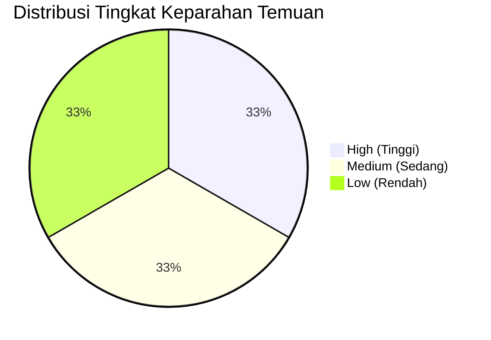
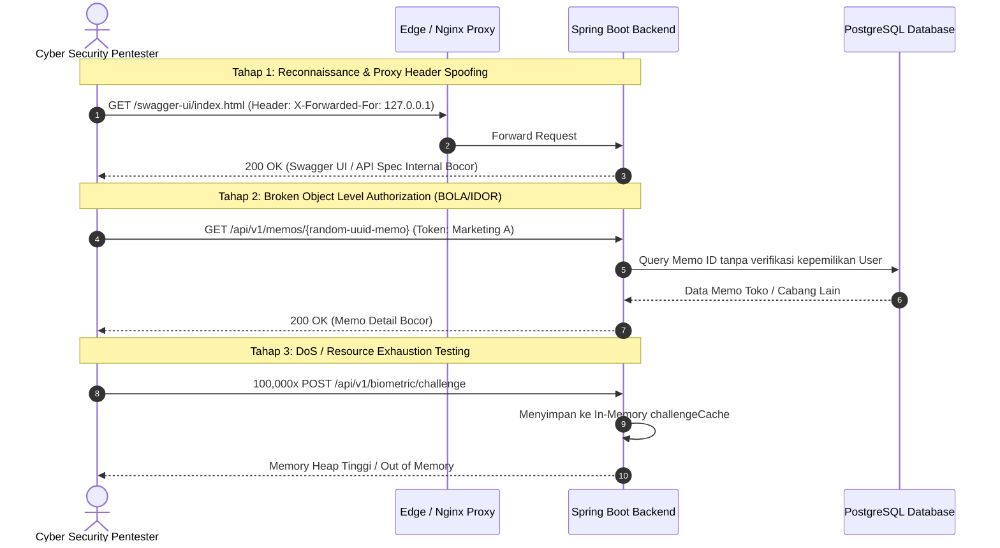

# 🛡️ Laporan Audit Keamanan Backend API (Security Audit Report)
**Aplikasi:** API Stok Anandam Computer  
**Framework:** Java Spring Boot 3 / PostgreSQL / Redis  
**Tanggal Audit:** 29 Agustus 2026  
**Status Audit:** Internal Source Code Security Review (Whitebox Assessment)  

---

## 📑 1. Ringkasan Eksekutif (Executive Summary)

Audit keamanan ini dilakukan untuk mengevaluasi postur keamanan backend API, mengidentifikasi kerentanan kode, menguji ketahanan autentikasi & otorisasi, serta menilai potensi celah yang dapat dieksploitasi oleh pihak ketiga maupun penguji keamanan siber (*Penetration Tester*).

### Ringkasan Tingkat Kerentanan
| Tingkat Keparahan (Severity) | Jumlah Temuan | Status Rekomendasi |
| :--- | :---: | :--- |
| 🔴 **High (Tinggi)** | 2 | Perlu Perbaikan Segera |
| 🟠 **Medium (Sedang)** | 2 | Jadwalkan Perbaikan |
| 🟡 **Low (Rendah)** | 2 | Rekomendasi Peningkatan |

---

## 🔍 2. Rincian Temuan Kerentanan (Detailed Vulnerability Findings)



---

### 🔴 SEC-01: IP Whitelisting Bypass via Header `X-Forwarded-For` Spoofing
* **Kategori:** Broken Access Control / Authentication Bypass
* **CVSS Score:** 7.5 (High)
* **File Terdampak:** [`src/main/java/com/stok/anandam/store/config/SecurityConfig.java`](file:///D:/My%20Code/api-stok-anandam/src/main/java/com/stok/anandam/store/config/SecurityConfig.java#L59-L74)

#### Deskripsi Kerentanan:
Metode helper `getClientIp()` membaca nilai header `X-Forwarded-For` secara langsung tanpa memvalidasi apakah request berasal dari trusted reverse proxy:
```java
private boolean isIpWhitelisted(HttpServletRequest request) {
    String ip = getClientIp(request);
    if (ip == null) return false;
    return "127.0.0.1".equals(ip) || "0:0:0:0:0:0:0:1".equals(ip) || ip.startsWith("192.168.1.");
}

private String getClientIp(HttpServletRequest request) {
    String xff = request.getHeader("X-Forwarded-For");
    if (xff != null && !xff.isBlank()) {
        return xff.split(",")[0].trim();
    }
    return request.getRemoteAddr();
}
```

#### Dampak & Risiko:
Penyerang eksternal dari internet dapat menambahkan header HTTP kustom:
```http
X-Forwarded-For: 127.0.0.1
```
Aplikasi akan menganggap request berasal dari `localhost`, sehingga penyerang dapat melewati filter `swaggerSecurityFilterChain` (Order 4) untuk melihat skema database dan dokumentasi API internal (`/v3/api-docs`).

#### Rekomendasi Perbaikan:
1. Jangan parsing header `X-Forwarded-For` mentah di tingkat kode aplikasi.
2. Terapkan pembatasan IP murni di layer Web Server / Reverse Proxy (Nginx / Cloudflare / WAF) dengan memblokir akses ke `/swagger-ui/**` dan `/v3/api-docs/**` dari IP publik.

---

### 🔴 SEC-02: Hardcoded Fallback Secret & Kredensial Database di Kode Sumber
* **Kategori:** Cryptographic Failures / Sensitive Data Exposure
* **CVSS Score:** 7.8 (High)
* **File Terdampak:** [`src/main/resources/application.properties`](file:///D:/My%20Code/api-stok-anandam/src/main/resources/application.properties#L9-L161)

#### Deskripsi Kerentanan:
File konfigurasi berisi nilai *fallback default* berupa password database, JWT secret, dan internal API key:
```properties
spring.datasource.pg.password=${DB_PG_PASSWORD:Letmein99+}
spring.datasource.portal.password=${DB_PORTAL_PASSWORD:Letmein9+9}
jwt.secret=${JWT_SECRET:KunciRahasiaIniHarusSangatPanjangDanAmanSekali32KarakterLebih}
app.internal-api-key=${INTERNAL_API_KEY:KUNCIRAHASIAJANGANSAMPAIORANGLAINTAU2026}
```

#### Dampak & Risiko:
Jika source code bocor atau repositori Git diakses pihak tidak berwenang, penyerang dapat:
1. Melakukan *offline cryptographic signing* untuk membuat JWT palsu dengan identitas `admin` (`ROLE_ADMIN`).
2. Mengakses seluruh endpoint internal `/api/v1/internal/**` menggunakan key statis.

#### Rekomendasi Perbaikan:
Hapus semua default password/secret dari `application.properties`. Wajibkan sistem mengambil variabel dari environment (`${DB_PG_PASSWORD}`) tanpa fallback. Aplikasi harus gagal start (*fail-fast*) jika environment variable penting tidak terdefinisi di production.

---

### 🟠 SEC-03: Potensi Memory Exhaustion (DoS) pada Endpoint Challenge Biometrik
* **Kategori:** Denial of Service / Improper Resource Management
* **CVSS Score:** 6.5 (Medium)
* **File Terdampak:** [`src/main/java/com/stok/anandam/store/service/BiometricAuthenticationService.java`](file:///D:/My%20Code/api-stok-anandam/src/main/java/com/stok/anandam/store/service/BiometricAuthenticationService.java#L36-L75)

#### Deskripsi Kerentanan:
Challenge untuk login biometrik disimpan di memori heap menggunakan `ConcurrentHashMap` tanpa mekanisme batas waktu (*Time-To-Live / TTL*) maupun pembersihan berkala (*eviction policy*):
```java
private final Map<String, String> challengeCache = new ConcurrentHashMap<>();
```
Challenge baru hanya dihapus jika fungsi `verifyAndAuthenticate()` berhasil dipanggil.

#### Dampak & Risiko:
Penyerang dapat membuat bot untuk mengirimkan jutaan request ke endpoint publik `/api/v1/biometric/challenge` tanpa pernah memanggil endpoint `/verify`. Hal ini menyebabkan objek di `challengeCache` terus bertambah hingga server kehabisan memori RAM (*OutOfMemoryError* / JVM Crash).

#### Rekomendasi Perbaikan:
Gunakan Redis Cache dengan TTL 60 detik (misal `redisTemplate.opsForValue().set(key, value, 60, TimeUnit.SECONDS)`) atau in-memory cache berfitur eviksi otomatis seperti Caffeine Cache:
```java
Cache<String, String> challengeCache = Caffeine.newBuilder()
    .expireAfterWrite(60, TimeUnit.SECONDS)
    .maximumSize(10_000)
    .build();
```

---

### 🟠 SEC-04: Argument Injection & Kurangnya Batasan Role pada Print Service
* **Kategori:** Command / Parameter Injection & Loose Access Control
* **CVSS Score:** 5.8 (Medium)
* **File Terdampak:** 
  * [`src/main/java/com/stok/anandam/store/controller/PrinterController.java`](file:///D:/My%20Code/api-stok-anandam/src/main/java/com/stok/anandam/store/controller/PrinterController.java#L21-L24)
  * [`src/main/java/com/stok/anandam/store/service/SilentPrintService.java`](file:///D:/My%20Code/api-stok-anandam/src/main/java/com/stok/anandam/store/service/SilentPrintService.java#L44-L50)
  * [`src/main/java/com/stok/anandam/store/config/SecurityConfig.java`](file:///D:/My%20Code/api-stok-anandam/src/main/java/com/stok/anandam/store/config/SecurityConfig.java#L128)

#### Deskripsi Kerentanan:
1. Endpoint `/api/v1/printer/**` diizinkan untuk semua pengguna yang memiliki token (`.authenticated()`), tanpa membatasi role khusus printer/operasional.
2. Parameter `printerName` dikirim langsung dari input user ke `ProcessBuilder`:
   ```java
   ProcessBuilder pb = new ProcessBuilder(
           "lp",
           "-d", printerName,
           "-o", "fit-to-page",
           tempFile.toAbsolutePath().toString()
   );
   ```

#### Dampak & Risiko:
1. Akun berhak akses rendah (misal teknisi lapangan atau sales magang) dapat memicu perintah cetak massal secara fisik di kantor.
2. Karakter atau flag yang tidak biasa dalam `printerName` berpotensi mengganggu antrean sistem cetak CUPS Linux.

#### Rekomendasi Perbaikan:
1. Batasi otorisasi di `SecurityConfig`:
   ```java
   .requestMatchers("/api/v1/printer/**").hasAnyAuthority("ROLE_ADMIN", "ROLE_GUDANG", "ROLE_NOTA")
   ```
2. Terapkan validasi regex ketat pada parameter `printerName`:
   ```java
   if (printerName != null && !printerName.matches("^[a-zA-Z0-9_-]{1,50}$")) {
       throw new IllegalArgumentException("Nama printer tidak valid");
   }
   ```

---

### 🟡 SEC-05: Tidak Ada Rate Limiting pada Endpoint Tracking Publik (Data Enumeration)
* **Kategori:** Identification and Authentication Failures / Information Disclosure
* **CVSS Score:** 4.3 (Low)
* **File Terdampak:** [`src/main/java/com/stok/anandam/store/controller/TrackingPublicController.java`](file:///D:/My%20Code/api-stok-anandam/src/main/java/com/stok/anandam/store/controller/TrackingPublicController.java#L27-L31)

#### Deskripsi Kerentanan:
Endpoint `/api/v1/public/tracking/phone?noTelepon=...` dapat diakses bebas tanpa autentikasi dan belum dilengkapi dengan pembatas laju request (*Rate Limiter*).

#### Dampak & Risiko:
Penyerang dapat menjalankan automated script untuk mencoba ribuan variasi nomor telepon lokal (`0812...`, `0813...`, dst.) guna memanen metadata transaksi servis, jenis perangkat, dan riwayat perbaikan pelanggan Anandam Computer.

#### Rekomendasi Perbaikan:
Terapkan Rate Limiter berbasis IP menggunakan Bucket4j / Nginx limit_req (maksimal 5–10 request per menit per alamat IP).

---

### 🟡 SEC-06: Verifikasi File Upload Belum Memeriksa Magic Bytes
* **Kategori:** Insecure File Upload
* **CVSS Score:** 3.8 (Low)
* **File Terdampak:** [`src/main/java/com/stok/anandam/store/service/FileService.java`](file:///D:/My%20Code/api-stok-anandam/src/main/java/com/stok/anandam/store/service/FileService.java#L16-L31)

#### Deskripsi Kerentanan:
Penyimpanan file bukti foto memo langsung menulis stream file ke folder static `uploads/memos/` yang disajikan publik (`/uploads/**`) tanpa memverifikasi signature biner asli (*magic bytes*).

#### Rekomendasi Perbaikan:
Periksa header biner file sebelum menyimpan (memastikan benar-benar format JPEG/PNG/PDF) dan pastikan web server mengirimkan header:
```http
X-Content-Type-Options: nosniff
```

---

## 🎯 3. Skenario Pengujian oleh Cyber Security / Penetration Tester

Berikut adalah simulasi alur uji penetrasi (*penetration testing playbook*) yang umumnya dilakukan oleh profesional keamanan siber:



---

## 📋 4. Matriks Rencana Tindak Lanjut (Action Plan)

| ID | Aksi Perbaikan | Prioritas | Estimasi Pengerjaan | Target Penyelesaian |
| :---: | :--- | :---: | :---: | :---: |
| **01** | Hapus default credentials dari `application.properties`, ganti murni Env Var | **P0 (Kritis)** | 1 Jam | Sprint Berjalan |
| **02** | Hapus logic spoofable `X-Forwarded-For` di `SecurityConfig`, serahkan ke Nginx | **P1 (Tinggi)** | 2 Jam | Sprint Berjalan |
| **03** | Ubah `challengeCache` biometrik ke Redis TTL / Caffeine Cache | **P1 (Tinggi)** | 3 Jam | Sprint Berjalan |
| **04** | Tambahkan validasi regex printer & batasi role endpoint `/api/v1/printer/**` | **P2 (Sedang)** | 1 Jam | Sprint Berikutnya |
| **05** | Pasang Rate Limiting pada endpoint `/api/v1/public/tracking/phone` | **P2 (Sedang)** | 3 Jam | Sprint Berikutnya |
| **06** | Tambahkan validasi Magic Bytes pada upload foto memo & resi | **P3 (Rendah)** | 2 Jam | Backlog Maintenance |

---
*Laporan ini dibuat sebagai panduan peningkatan keamanan internal (Defensive Security & Hardening Guide) untuk backend API Anandam Computer.*
